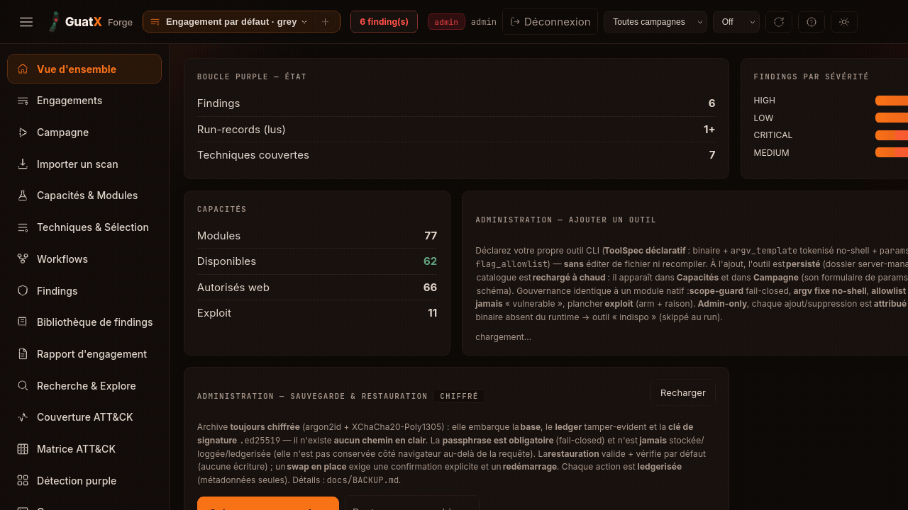

<div align="center">

# 🔨 Forge

[English](README.md) | [Français](README.fr.md)

**The heavyweight red-team engine.** — the offensive counterpart of [Plume](https://github.com/guatxlabs/plume), the blue-team SOC.
*Python · stdlib-only core · safety first (fail-closed ROE + tamper-evident ledger).*

**·  by [GuatX](https://guatx.com)  ·  authorized use only  ·**

**License: [AGPL-3.0-or-later](LICENSE) — 100 % open source**  ·  Advanced modules (flag-gated, OFF by default) → [`ADVANCED_MODULES.md`](docs/ADVANCED_MODULES.md)

<br>



<sub>Forge console — dashboard · module catalog (the **exploit/destructive** ones are gated by the ROE) · **ATT&CK**-mapped findings · **governed launch** (out-of-scope = hard VETO, every shot in the **ledger**). The registry holds **88 modules** — a count MEASURED by `python3 -m forge.cli modules --json`, not read off this screenshot.</sub>

</div>

Plume **observes** (the quill that records, blue). Forge **strikes** — and **tempers** Plume's
defenses (the purple-team loop). Forge orchestrates attack modules (recon → enum → exploit) where
**every action goes through a fail-closed ROE gate** and is recorded in an **append-time,
tamper-evident engagement ledger**. By default, Forge is **INERT**: nothing can fire until the
operator has consciously armed every layer.

> ⚠️ **Authorized settings only** (in-scope bug bounty, contracted pentest, CTF, your own infra).
> The ROE gate + the scope-guard + the ledger are there to **enforce AND prove** authorization.
> Getting past a WAF/Cloudflare ≠ a vulnerability: it is an access enabler, not a bug.

> 📚 **Full product documentation → [`docs/`](docs/README.md)** — overview, architecture,
> installation, first-deployment wizard, configuration reference (env + settings), administration,
> concepts, CLI & HTTP API reference, standalone, security model, uninstall, troubleshooting.

## Safety first — the 4-layer gate (`forge/roe.py`)

All of them must be passed for a LIVE action to go out. Otherwise: `DRY_RUN` (simulation) or
`VETO` (hard refusal).

| Layer | Question | Failure → |
|---|---|---|
| 1 — armed? | engagement explicitly armed (`--arm`)? | `DRY_RUN` |
| 2 — scope? | target ∈ `in_scope` and ∉ `out_scope`? (**fail-closed**: empty `in_scope` = nothing) | `VETO` |
| 3 — capability? | exploit/destructive ⇒ explicit `allow_exploit`/`allow_destructive`? | `VETO` |
| 4 — approved? | action approved (`--approve`), or `auto` mode? | `DRY_RUN` |

`VETO` (layer 2/3) is **never** simulated or fired. Any evaluation error ⇒ `VETO` (fail-closed).

## Install

```sh
pip install -e .          # puts the `forge` executable on the PATH (forge = forge.cli:main)
forge doctor              # diagnostics: operational modules + tool/service expected per module
```

Without installing, everything is also reachable via `python3 -m forge.cli <commande>`.

## Quickstart

> 🚀 **New?** The end-to-end operator walkthrough, **100 % offline** (seed + mock-Plume, no
> external service), is in [`docs/GETTING_STARTED.md`](docs/GETTING_STARTED.md) — install → scope →
> campaign/`make demo` → console → purple matrix → report → integrity check, with a
> "what you should see" checkpoint at each step.

```sh
# end-to-end demonstration — NO real target, NO network I/O
forge demo                                  # or: python3 -m forge.cli demo

# full suite (stdlib, zero network): Python unittest + cargo test of the console
make test                                   # = python3 -m unittest discover -s tests -t . + (cd console && cargo test)
python3 -m unittest discover -s tests -t .  # Python only (2949 tests — MEASURED on 2026-11-24: `Ran 2949 tests` / `OK (skipped=5)`)

# check whether a target is in scope
forge scope-check app.exemple.test --scope scope.json

# plan (shows the ROE verdict of each action, fires nothing)
forge plan --scope scope.json --actions actions.json

# run — INERT by default; you must arm AND approve to fire
forge run --scope scope.json --actions actions.json \
    --ledger engagements/e1.jsonl --report rapport.md            # everything in DRY_RUN
forge run --scope scope.json --actions actions.json \
    --arm --approve demo.fingerprint:app.test --ledger engagements/e1.jsonl

# engagement integrity
forge ledger verify --ledger engagements/e1.jsonl
```

Copy `scope.example.json` → `scope.json` and fill in `in_scope` **with written authorization**.
`scope.json`, `*.key`, `*.jsonl` are gitignored (secrets / engagement state).

### Instant demo — console populated in 1 command (offline)

A **synthetic reference engagement** is provided in
[`examples/reference-engagement/`](examples/reference-engagement/) (reserved `.example` hosts,
documentation IPs — **no real target, no real SOC**). It immediately populates the
Findings / Coverage / Purple / Runs tabs:

```sh
make demo          # seeds the demo database + launches the populated console  -> http://127.0.0.1:7100
make demo-purple   # same + mock-Plume stub (DEMO FIXTURE) -> detected/missed/MTTD matrix (7 fired, 4 detected, 3 missed)
```

`make demo` runs `forge seed-demo --dir examples/reference-engagement`, which **ingests the
fixtures directly into SQLite** (idempotent, no network, touches only the `acme-lab` demo
campaign). The matching commercial write-up:
[`examples/reference-engagement/REFERENCE_ENGAGEMENT.md`](examples/reference-engagement/REFERENCE_ENGAGEMENT.md).

## Rust console (`console/` — the store + the purple loop)

Minimal fork of the Plume backbone (axum + rusqlite, single binary): store for the RED model
(`finding`/`runrecord`), API, and the **purple junction point** (`POST /api/ingest` receives the
ATT&CK findings + run-records from the Python engine; Plume then correlates on the `mitre` field).

```sh
cd console && cargo build --release            # builds offline from the cargo cache
# (optional) enable operator auth: argon2id hash of the password, never in plaintext
HASH=$(./target/release/forge hashpw 'mon-mot-de-passe')
FORGE_CONSOLE_TOKEN=$(openssl rand -hex 16) \
FORGE_CONSOLE_USER=forge FORGE_CONSOLE_PASS_HASH="$HASH" \
    ./target/release/forge            # http://127.0.0.1:7100  (without PASS_HASH = open localhost dev)
# engine side: ship a campaign to the console
python3 -m forge.cli campaign --scope scope.json --targets t.json --campaign op1 \
    --console http://127.0.0.1:7100 --console-token "$FORGE_CONSOLE_TOKEN"
```

**Auth/RBAC** (Plume's `auth_guard`/`host_guard` model): `/health` open; all other
routes behind (a) the anti-DNS-rebinding **host-guard** (`Host` in allowlist → otherwise `421`) and (b) the
**auth-guard** if `FORGE_CONSOLE_PASS_HASH` is set — **Basic** (operator=viewer, read) or
**Bearer token** (agent/admin=write). Without a hash → open localhost dev mode (writes
remain gated by the token). **argon2id** password via `forge hashpw '...'`.
Endpoints: `GET /health` · `POST /api/ingest` (token) · `GET /api/findings` · `GET /api/runrecords` ·
`GET /api/coverage` (ATT&CK rollup) · **`GET /api/query?q=...`** (GXQL) · **`/api/panels`** (GET list ·
POST create [token] · DELETE [token] · `GET /api/panels/:id/data`) · `GET /` (dark operator console,
vanilla-JS: GXQL search bar + table/bar/stat **panel dashboard**).
Store-level dedup (`UNIQUE(campaign,target,title)`). Bind 127.0.0.1; full auth/RBAC = hardening.

**GXQL (SPL-like query language, ported from Plume)** — *GuatX Query Language*, **formerly
"SOQL"**: same language, same syntax, only the name changes; the CLI flag `--soql`, the JSON key
`soql` and the `guatx_core::soql` module remain unchanged. Queries `finding`/`runrecord`,
compiled to **read-only SQL** (allowlisted fields, values as bound params, a single SELECT, LIMIT
capped, `SQLITE_OPEN_READ_ONLY` connection). Examples:
```
search severity=HIGH | fields target,title,mitre
search | stats count by severity | sort -count
search title~Origine
runs | stats count by mitre
```
A field outside the allowlist → `400` (anti-injection). The compiled SQL is returned (transparency).

### Console quickstart (≈5 min)

```sh
# 1) build the binary (offline, from the cargo cache)
cd console && cargo build --release && cd ..

# 2) launch the console (dev: open localhost, writes gated by token)
FORGE_CONSOLE_TOKEN=$(openssl rand -hex 16) ./console/target/release/forge &
#    -> http://127.0.0.1:7100   (dark operator UI + API)

# 3) populate the module catalog on the UI side
forge modules --json                       # lists the modules of the registry (kind, mitre, availability)

# 4) ingest a demonstration campaign (zero network, synthetic finding)
FORGE_CONSOLE_URL=http://127.0.0.1:7100 FORGE_CONSOLE_TOKEN=$FORGE_CONSOLE_TOKEN \
    python3 demo_ingest.py                 # FIRE demo.fingerprint -> POST /api/ingest
```

> In a container: the console binds `127.0.0.1:7100` by default (`FORGE_CONSOLE_ADDR`). To
> expose it, set `FORGE_CONSOLE_ADDR=0.0.0.0:7100`, add the public hostname to the anti-rebinding
> host-guard via `FORGE_CONSOLE_HOST`, **and** set `FORGE_CONSOLE_PASS_HASH` (argon2id auth)
> — never expose the open-localhost dev mode outside the machine.

## Connectors (standard pentest tools, driven by Forge)

Forge adds no offensive capability of its own: two connectors **drive** standard pentest
tools that the operator already runs themselves, and **map** their results into
Findings behind the same ROE gate. Both probe their service **at fire-time** (never at
catalog time) and neutralize themselves if the service is unreachable.

| Module | Driven tool | Env variables (defaults) |
|---|---|---|
| `msf.module` | **msfrpcd** (msgpack RPC) — launches the MSF module chosen by the operator; no payload generated by Forge | `MSF_RPC_HOST` (127.0.0.1) · `MSF_RPC_PORT` (55553) · `MSF_RPC_USER` (msf) · `MSF_RPC_PASS` · `MSF_RPC_SSL` (true) · `MSF_RPC_TOKEN` (permanent token, optional) |
| `burp.scan` | **Burp Suite REST API** Pro/Enterprise — launches an in-scope scan, brings back the issues | `BURP_API_URL` (http://127.0.0.1:1337) · `BURP_API_KEY` |

Governance: `msf.module` declares `exploit=True` (fail-safe → the engine requires `allow_exploit`);
`burp.scan` stays `exploit=False` but emits `reported_by_tool` (never `vulnerable` — like nuclei,
no over-classification without evidence of exploitability). `forge doctor` shows which ones are reachable.

## Architecture (in short)

```
  cerveau (planner heuristique, seam orchestrateur LLM)
        │  propose des Actions (kind, target, exploit?, destructive?)
        ▼
  Engine ──► gate ROE ──► VETO | DRY_RUN | FIRE ──► Ledger (append-time, hash-chain + HMAC)
        │                                  │
        │                                  ▼ (FIRE seulement)
        └──► module.fire() ──► Findings ──► report.py (+ section anti-masquage)
                  ▲
        modules = OUTILS AUTONOMES orchestrés (recon, oracles à preuve, évasion navigateur, connecteurs)
```

- **Core** = `roe.py` (gate) + `ledger.py` (evidence) + `engine.py` + `schema.py`. Pure stdlib.
- **Modules** stay independent (the `Module` only does `dry()`→PoC and `fire()`→findings).
- **Purple loop**: every finding carries a `mitre` field (ATT&CK) = join key to validate
  detection on the defense side (BAS). The **detection source is a configurable plugin** (Plume is only a
  preset — CrowdSec, FortiGate, pfSense/OPNsense, Elastic/OpenSearch, file, exec are wired without
  code): see [`docs/DETECTION.md`](docs/DETECTION.md) and [`ARCHITECTURE.md`](ARCHITECTURE.md).

## Status

Pre-1.0, **[AGPL-3.0-or-later](LICENSE)**, 100 % open source. **88 modules** (MEASURED count:
`python3 -m forge.cli modules --json` → 88 entries, 13 `exploit`, 42 `bug_bounty_eligible`); suites
green **offline** — **2949** Python tests (`Ran 2949 tests` / `OK (skipped=5)`, each skip naming the optional tool or corpus
it lacks) and **571** Rust
console tests (`cargo test`, default features), MEASURED on 2026-11-24.

What is **delivered**, **open** and **accepted** lives in **[`ROADMAP.md`](ROADMAP.md)**; the detailed
module catalog in **[`docs/MODULES.md`](docs/MODULES.md)**. The source of truth for the counts is
the command, not this page.

## Production deployment (self-deploy)

Full runbook: **[`docs/DEPLOYMENT.md`](docs/DEPLOYMENT.md)**. In short — the build context is the
root of this repository (the console resolves `guatx-core` through a public git-dep pinned to tag `v0.2.2`,
no sibling crate required; `console/Cargo.lock` is committed for reproducible builds):

```sh
cp scope.example.json scope.json          # INERT while in_scope is empty; edit WITH AUTHORIZATION
docker compose up -d --build              # console ONLY (loopback :7100, healthcheck GET /health)
```

Open `http://127.0.0.1:7100` → the **first-boot wizard** provisions the admin (argon2id RBAC), the crypto,
the **detection source of YOUR infra** (FortiGate/pfSense/CrowdSec/Elastic/… — [`docs/DETECTION.md`](docs/DETECTION.md),
no-code plugin) and the operator policy — **nothing hard-coded**. Optional services
(browser/msf/burp) behind **profiles** (`--profile browser`), no hard `depends_on` → a bare `up` =
console only. **Encryption at rest** (opt-in SQLCipher image) and **scheduled encrypted backups**
(offsite): [`docs/MIGRATION.md`](docs/MIGRATION.md) · [`docs/BACKUP.md`](docs/BACKUP.md).

## Uninstall

Full procedure (including state purge and removal of the orchestrated tools):
**[`docs/UNINSTALL.md`](docs/UNINSTALL.md)**. In short, **per deployment mode**:

```sh
# Docker Compose — from the repository root
docker compose down                 # stops, KEEPS the volumes (DB + ledger)
docker compose down -v              # stops + DELETES the volumes (DESTRUCTIVE)
docker image rm forge:0.0.1         # removes the image

# Docker (standalone container)
docker rm -f forge && docker image rm forge:0.0.1

# Native / systemd (without Docker)
sudo systemctl disable --now forge
sudo rm -f /etc/systemd/system/forge.service && sudo systemctl daemon-reload
sudo rm -rf /opt/forge              # binary + assets (adapt to the install path)

# Python engine installed as editable
pip uninstall forge
```

> **Data purge (DESTRUCTIVE, irreversible for auditability)** — the SQLite DB (+ WAL/SHM), the
> engagement ledger and its **`.ed25519` signing key**, the active scope and the encrypted backups
> are **never** deleted unless you explicitly target them. The exact paths and the
> removal of the orchestrated tools (msf/burp/browser) are in [`docs/UNINSTALL.md`](docs/UNINSTALL.md).

## Documentation

**➡️ Full, navigable table of contents: [`docs/README.md`](docs/README.md)** — the whole of the
product documentation (overview, architecture, installation, configuration, administration,
concepts, CLI, HTTP API, security, troubleshooting). The key pages:

- [`docs/OVERVIEW.md`](docs/OVERVIEW.md) — **what Forge is**, the value, standalone operation.
- [`docs/ARCHITECTURE.md`](docs/ARCHITECTURE.md) — **how it is built** (Python engine + Rust console + SPA + governance).
- [`docs/CONFIGURATION.md`](docs/CONFIGURATION.md) — **complete reference** of the env variables and `settings` keys.
- [`docs/CLI.md`](docs/CLI.md) · [`docs/HTTP_API.md`](docs/HTTP_API.md) — CLI & HTTP API references.
- [`docs/GETTING_STARTED.md`](docs/GETTING_STARTED.md) — **end-to-end offline start** (seed + mock-Plume): install → scope → console → purple → report → integrity.
- [`docs/PLAN.md`](docs/PLAN.md) — positioning, red/blue/purple, sequenced roadmap and blocker status.
- [`docs/DETECTION.md`](docs/DETECTION.md) — **detection source = configurable plugin** (plug in any BLUE infra without code: Plume/CrowdSec/FortiGate/pfSense/OPNsense/Elastic/file/exec) + `DetectionSource` model and MITRE mapping.
- [`docs/PURPLE_PREREQS.md`](docs/PURPLE_PREREQS.md) — prerequisites of the **Plume** preset to wire the purple loop (the moat) — a special case of `DETECTION.md`.
- [`docs/DEPLOYMENT.md`](docs/DEPLOYMENT.md) — **end-to-end self-deploy runbook**: build/run (mini·full · Docker · compose · native/systemd · SQLCipher `encryption` image), **first-boot wizard** (admin · crypto · detection source · operator policy — nothing hard-coded), migration & **encrypted backups** (schedule/offsite), `guatx-core` build context, `/health` liveness. Includes the measured footprint + matrix (Docker / k8s / host / venv).
- [`docs/PLATFORMS.md`](docs/PLATFORMS.md) — **OS support matrix** (Linux primary · macOS fully supported · Windows best-effort): what works everywhere vs the only Unix-only capability (`setsid`/`killpg` subtree kill of the C2 run), and how config/data/temp directories are resolved per OS.
- [`docs/MIGRATION.md`](docs/MIGRATION.md) — take over an existing install (DB + ledger + `.ed25519` key) to Docker/another target; SQLCipher encryption-at-rest option.
- [`docs/BACKUP.md`](docs/BACKUP.md) — backup/restore, **always encrypted** (argon2id + XChaCha20-Poly1305), scheduling + **offsite** shipping.

## License & model

Forge is **100 % open source** under **[AGPL-3.0-or-later](LICENSE)** — **the whole product**, with no paid
offering and no crippled feature. "Open" does not mean "without rules": the AGPL is a **strong copyleft**,
with **obligations** to respect (see below and [`LICENSE`](LICENSE)).

- **The core** — free, self-hostable, always on: fail-closed ROE scope-guard, tamper-evident Ed25519
  authorization ledger, evidence-oriented oracles, extensible technique registry +
  all technique classes, governed C2-light run, console (UI + wizard + admin/operator/
  viewer RBAC), connectors/orchestration (nuclei/msf/burp/…), infra-agnostic detection, encrypted
  backup/restore and purple loop — **everything needed to run Forge solo or in a small team**.
  Since it is AGPL, any network deployment must offer the corresponding source to its
  users (§13), any derivative stays under AGPL-3.0, and license notices are preserved.
- **The advanced modules** — **open as well**, separable and **flag-gated, OFF by default**: the
  **scale / team / compliance** layer — multi-tenant/MSSP (per-tenant crypto isolation), SSO/SCIM, advanced
  composable RBAC & per-engagement grants, HA/clustering/distributed store (Postgres), compliance (SOC2/ISO
  evidence, legal-hold/WORM retention, KMS/HSM keys). You enable them when you need them; left OFF, the
  build is **byte-identical** to the core.

**Principle**: the **governance core + cryptographic audit stays OPEN and verifiable** — that is the whole
credibility of the product. The scale/team/compliance capabilities are **separable modules**, open and
flag-gated. Details: **[`ADVANCED_MODULES.md`](docs/ADVANCED_MODULES.md)**. GuatX's commercial offering is about
**professional services** (engagements, purple coaching, support/SLA, managed hosting),
never a license of the code — see **[`docs/PRICING.md`](docs/PRICING.md)**.

> **Authorized / ethical use only.** The AGPL license covers the *code*; it authorizes **no**
> offensive action outside an explicitly authorized scope (in-scope bug bounty, contracted pentest,
> CTF, your own infra). The ROE gate + the scope-guard + the ledger are there to enforce AND prove that
> authorization.
